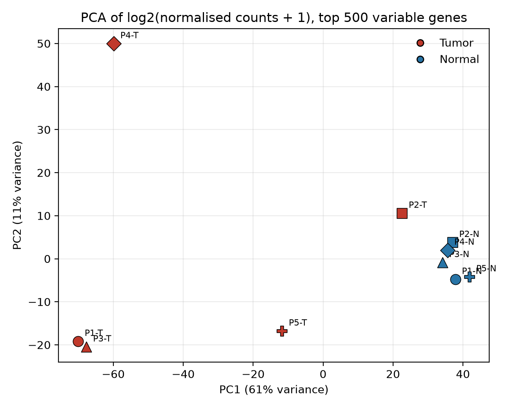
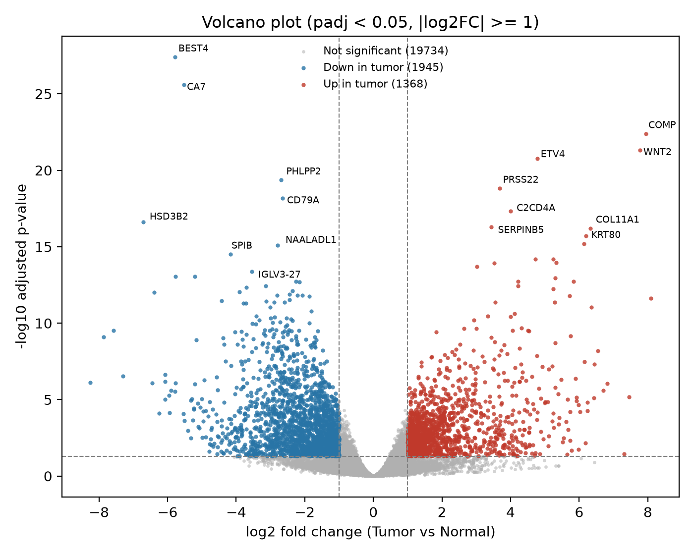
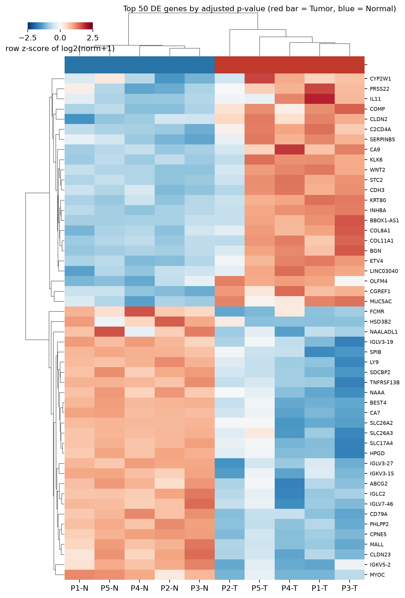
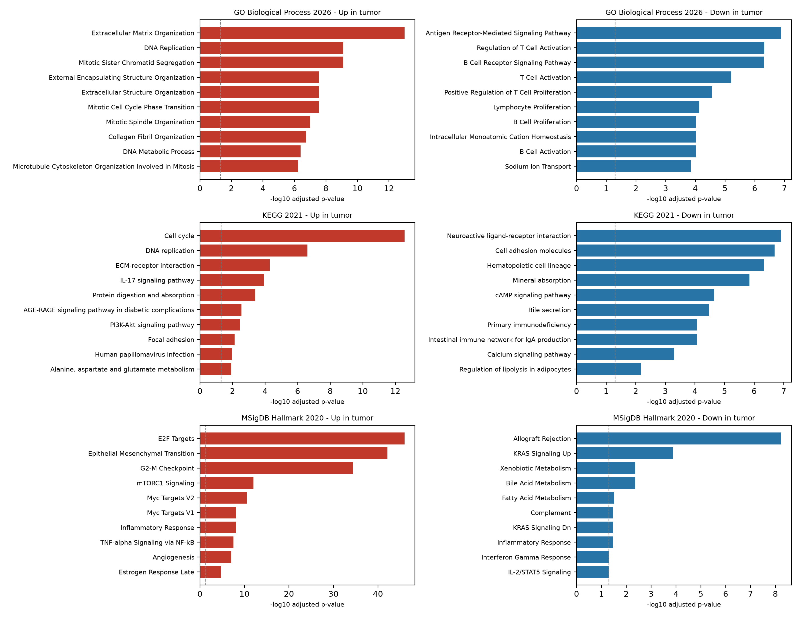

# RNA-Seq Differential Expression Analysis: Colorectal Cancer (Tumor vs. Matched Normal)

**Status:** ✅ Weeks 1–7 complete — 🔄 Week 8 (final write-up) in progress
**Author:** Kumar | **Supervisor:** Dr. Nilofer

## Overview

This project identifies differentially expressed genes (DEGs) between primary colorectal tumor tissue and matched adjacent normal tissue, using a subset of a published RNA-seq dataset. The pipeline covers the full workflow from raw sequencing reads through alignment, quantification, paired differential expression testing, visualization and pathway enrichment, with every decision, parameter and tool version documented.

**Headline result:** 3,313 genes are differentially expressed (adjusted p < 0.05, |log2FC| ≥ 1) — 1,368 up and 1,945 down in tumor. Tumors show a proliferative and matrix-remodelling signature (E2F targets, G2-M checkpoint, epithelial-mesenchymal transition) and loss of normal colon-lining function and lymphocyte-signalling genes. Top genes (BEST4, CA7 down; COMP, WNT2, ETV4 up) match known colorectal cancer biology.

## Dataset

- **Source:** [GSE50760](https://www.ncbi.nlm.nih.gov/geo/query/acc.cgi?acc=GSE50760) (Gene Expression Omnibus)
- **Original publication:** Kim, S.K. et al. (2014), *PLoS ONE*. PMID: [25049118](https://pubmed.ncbi.nlm.nih.gov/25049118/)
- **Subset used:** 10 paired-end samples — 5 patients × (1 primary tumor + 1 matched normal colon sample each)
- **Design rationale:** paired tumor/normal samples from the same patients increase statistical power for DE testing; the full dataset (54 samples, 18 patients) was subset for computational feasibility

| Patient | Tumor SRR | Normal SRR |
|---|---|---|
| P1 | SRR975554 | SRR975572 |
| P2 | SRR975556 | SRR975574 |
| P3 | SRR975559 | SRR975577 |
| P4 | SRR975564 | SRR975582 |
| P5 | SRR975567 | SRR975585 |

Full sample metadata: [`metadata/sample_metadata.csv`](metadata/sample_metadata.csv)

## Pipeline

```
Raw FASTQ (SRA download)          ✅ 20 files downloaded & verified
    ↓ FastQC / MultiQC            ✅ results/week1_multiqc_report.html
    ↓ fastp                       ✅ 82.5% read retention, Q20 rate 97.5%
    ↓ FastQC / MultiQC            ✅ results/week2_multiqc_trimmed_report.html
    ↓ STAR (GRCh38 + GENCODE 50)  ✅ 90.9% mean uniquely mapped, 97.3% total mapped
    ↓ featureCounts               ✅ unstranded library (-s 0), 78,941 genes × 10 samples
    ↓ DESeq2 (Galaxy)             ✅ paired design (condition + patient), 3,313 DEGs
    ↓ PCA / volcano / heatmap     ✅ scripts/week6_analysis.py
    ↓ Enrichr (GO, KEGG, Hallmark)✅ scripts/week7_enrichment.py
    ↓ Final write-up              🔄 Week 8
```

## Key Results

### Sample-level structure (PCA)


PC1 (61% of variance) separates tumor from normal. Normals cluster tightly; tumors are heterogeneous. Tumor P2 (SRR975556) is the most normal-like tumor, and tumor P4 (SRR975564) is an outlier on PC2.

### Differentially expressed genes




All five tumors cluster apart from all five normals. Comparison direction is **Tumor vs. Normal** (positive log2FC = higher in tumor).

### Pathway enrichment


| Direction | Main themes |
|---|---|
| Up in tumor | Proliferation (E2F targets, G2-M checkpoint, Myc targets, DNA replication, cell cycle); matrix remodelling and mesenchymal programme (EMT, ECM organisation) |
| Down in tumor | Normal colon function (mineral absorption, xenobiotic, bile-acid and fatty-acid metabolism); lymphocyte signalling (T-cell and B-cell receptor pathways) |

Detailed tables: [`results/deseq2_summary.txt`](results/deseq2_summary.txt), [`results/enrichment_summary.txt`](results/enrichment_summary.txt).

## Tools & Versions

| Tool | Version | Purpose |
|---|---|---|
| sra-tools | 3.4.1 | SRA download (prefetch, fasterq-dump) |
| FastQC | v0.12.1 | Read quality control |
| MultiQC | 1.35 | Aggregate QC reporting |
| fastp | 1.3.6 | Adapter/quality trimming |
| STAR | 2.7.10b | Read alignment |
| SAMtools | 1.24 | BAM validation |
| Subread (featureCounts) | v2.1.1 | Read quantification |
| GENCODE | release 50 (GRCh38.p14), primary assembly, Basic annotation | Reference genome and annotation |
| DESeq2 (Galaxy tool, usegalaxy.org) | 2.11.40.8+galaxy4 | Differential expression |
| Python (pandas, numpy, scipy, matplotlib, seaborn) | see `environment.yml` | Annotation, statistics, figures |
| Enrichr via gseapy | see `environment.yml` | Over-representation analysis (GO Biological Process, KEGG, MSigDB Hallmark) |

Full environment setup and version log: [`docs/week1_setup_and_data_retrieval.md`](docs/week1_setup_and_data_retrieval.md) and [`docs/project_log.md`](docs/project_log.md).

## Repository Structure

```
├── metadata/
│   └── sample_metadata.csv                 # sample-to-condition mapping
├── scripts/
│   ├── week6_analysis.py                   # annotation, DEG summary, PCA, volcano, heatmap
│   └── week7_enrichment.py                 # GO / KEGG / Hallmark enrichment (Enrichr)
├── counts/
│   ├── gene_counts_matrix.tsv              # featureCounts matrix (78,941 genes × 10 samples)
│   ├── gene_id_to_name.tsv                 # GENCODE gene ID → symbol
│   └── gene_counts_raw.txt.summary         # featureCounts assignment summary
├── docs/
│   ├── week1_setup_and_data_retrieval.md
│   ├── week2_quality_trimming.md
│   ├── week2_qc_comparison.md
│   ├── week3_alignment.md
│   ├── week4_quantification.md
│   ├── week5_differential_expression.md
│   ├── week6_visualization.md
│   ├── week7_enrichment.md
│   └── project_log.md                      # running log: decisions, tool versions, literature
├── results/
│   ├── week1_multiqc_report.html           # raw-read QC
│   ├── week2_multiqc_trimmed_report.html   # post-trimming QC
│   ├── deseq2_results_tumor_vs_normal.tsv  # raw Galaxy DESeq2 output
│   ├── deseq2_results_annotated.tsv        # with gene names and DEG labels
│   ├── deseq2_significant_genes.tsv        # the 3,313 DEGs
│   ├── deseq2_summary.txt, size_factors.tsv, deseq2_plots_galaxy.pdf
│   ├── enrichment_*.tsv, enrichment_summary.txt
│   └── fig_pca.png, fig_volcano.png, fig_heatmap_top50.png, fig_enrichment.png
└── README.md
```

Raw and intermediate data (FASTQ, BAM, genome files, STAR index) are excluded via `.gitignore` due to size — see the Dataset section to re-download the exact samples used.

## Reproducing This Analysis

1. **Environment:** create the conda environment from `environment.yml` (tool versions above; setup details in `docs/week1_setup_and_data_retrieval.md`).
2. **Data:** download the SRR accessions listed above with `prefetch` / `fasterq-dump`.
3. **Processing (command line):** QC and trimming → STAR index and alignment → featureCounts. Exact commands, parameters and rationale are in the weekly documents `docs/week2_*` to `docs/week4_*`. The two annotation-dependent steps must use the same GTF (GENCODE v50 Basic).
4. **Differential expression:** split `counts/gene_counts_matrix.tsv` into per-sample files and run DESeq2 on Galaxy with `condition` (Tumor first) and `patient` as factors — see `docs/week5_differential_expression.md`. The raw output is saved as `results/deseq2_results_tumor_vs_normal.tsv`.
5. **Downstream analysis:** `python scripts/week6_analysis.py` then `python scripts/week7_enrichment.py` (the latter needs internet access).

## Limitations

- **Small sample size:** five pairs. Effect sizes are estimates, and tumor heterogeneity is visible (P2 and P4 tumors differ from the others).
- **Bulk tissue:** differences partly reflect which cell types are present (e.g. stromal and immune content), not only expression changes within tumor cells.
- **Counting choices:** multi-mapped reads are not counted (6.4% of reads on average); the library is unstranded.
- **Enrichment:** Enrichr's web service uses its default background gene set, not the expressed genes of this experiment.
- **Fold changes:** the Galaxy DESeq2 output is unshrunken, so effect sizes of low-count genes can be inflated; rankings by adjusted p-value are unaffected.
- **Design formula:** `patient` was included as a second factor on the Galaxy form; confirmation of the exact model formula in the job output is noted as an open item in `docs/week5_differential_expression.md`.

## Progress Log

See [`docs/project_log.md`](docs/project_log.md) for a detailed log of every step, tool version, decision and literature reference used throughout the project.

## References

1. Kim, S.K. et al. (2014). Comprehensive molecular characterization of clinical colorectal cancers by RNA-seq. *PLoS ONE*. PMID: 25049118.
2. Love, M.I., Huber, W., Anders, S. (2014). Moderated estimation of fold change and dispersion for RNA-seq data with DESeq2. *Genome Biology* 15:550.
3. Griffith Lab GenViz Course — Differential Expression tutorial (reference/sanity-check resource): https://genviz.org/module-04-expression/
4. Andrews, S. (2010). FastQC: A Quality Control Tool for High Throughput Sequence Data.
5. Ewels, P. et al. (2016). MultiQC: summarize analysis results for multiple tools and samples in a single report. *Bioinformatics*. DOI: 10.1093/bioinformatics/btw354
6. Chen, S. et al. (2018). fastp: an ultra-fast all-in-one FASTQ preprocessor. *Bioinformatics* 34(17):i884–i890.
7. Dobin, A. et al. (2013). STAR: ultrafast universal RNA-seq aligner. *Bioinformatics* 29(1):15–21.
8. Liao, Y., Smyth, G.K., Shi, W. (2014). featureCounts: an efficient general purpose program for assigning sequence reads to genomic features. *Bioinformatics* 30(7):923–930.
9. Frankish, A. et al. (2021). GENCODE 2021. *Nucleic Acids Research* 49(D1):D916–D923.
10. The Galaxy Community (2024). The Galaxy platform for accessible, reproducible, and collaborative data analyses: 2024 update. *Nucleic Acids Research* 52(W1):W83–W94.
11. Chen, E.Y. et al. (2013). Enrichr: interactive and collaborative HTML5 gene list enrichment analysis tool. *BMC Bioinformatics* 14:128; Kuleshov, M.V. et al. (2016). *Nucleic Acids Research* 44(W1):W90–W97.
12. Fang, Z., Liu, X., Peltz, G. (2023). GSEApy: a comprehensive package for performing gene set enrichment analysis in Python. *Bioinformatics* 39(1):btac757.
13. Liberzon, A. et al. (2015). The Molecular Signatures Database Hallmark gene set collection. *Cell Systems* 1(6):417–425.

*(Citation details should be checked against the publisher records before the final report is submitted.)*
